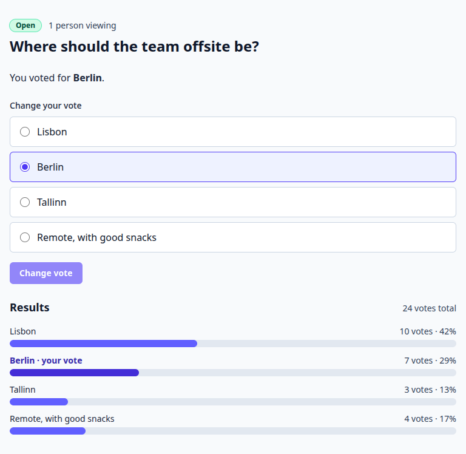
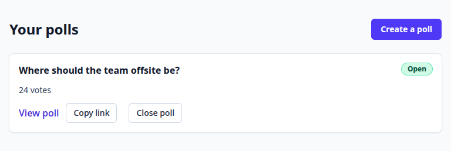
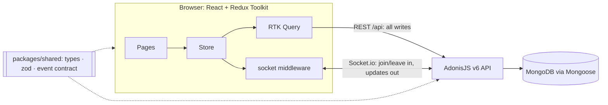

# LivePoll

Create a poll, share the link, and watch the results update live on every open screen.

A small full-stack TypeScript project built to be read: an **AdonisJS v6** API with **MongoDB
(Mongoose)**, real-time updates over **Socket.io**, and a **React + Redux Toolkit** front end
whose socket lives in a Redux middleware. The interesting parts are the concurrency-safe voting
(no double votes, exact counters under parallel load) and the live update / reconnect flow.

| Voting page (live results)                                | Creator dashboard                                          |
| --------------------------------------------------------- | ---------------------------------------------------------- |
|  |  |

**What a session looks like:** the creator registers, creates "Where should the team offsite
be?" and copies the link. Two colleagues open it on their phones: the header shows "3 people
viewing". Each vote moves the bars on all three screens immediately. When the creator clicks
**Close poll** on the dashboard, both phones switch to "This poll is closed" without a reload.

## Features

- Creators register / log in / log out (email + password).
- Create a poll: question (3–200 chars), 2–8 options, optional "allow changing vote". Each poll
  gets an 8-character public link `/p/:slug`.
- Anyone with the link can vote once (anonymous, cookie-based). A second vote is rejected (409),
  or moves the vote if the poll allows changes.
- Results (counts + percentages) and an "N people viewing" counter update live via Socket.io.
- Creators close polls from their dashboard: voting stops (409) and every open screen goes
  read-only immediately.
- Accessible: keyboard-operable voting, labelled controls, visible focus, `aria-live` results,
  WCAG AA contrast (checked with axe in the E2E suite).

## Architecture



- **REST for writes, sockets for reads.** Voting is a normal HTTP request (validation, rate
  limiting, clear status codes). The API then broadcasts `poll:updated` to the poll's room.
- **One vote per voter is enforced by MongoDB**, with a unique index on `(pollId, voterId)`.
  Counters change only with atomic `$inc`, and vote changes are a compare-and-swap.
- **Components never touch the socket.** The poll page dispatches `watchPoll(slug)`; a Redux
  middleware joins the room, turns server events into actions, and re-joins plus refetches after
  a reconnect.

The full write-up, including why Mongoose instead of Lucid, the double-vote proof and the
reconnect strategy, is in [docs/ARCHITECTURE.md](docs/ARCHITECTURE.md). Every non-obvious choice
is logged in [docs/DECISIONS.md](docs/DECISIONS.md).

### Project structure

```
apps/
  api/                    AdonisJS v6 API
    app/controllers/      auth, polls, health
    app/models/           Mongoose models: user, poll, vote
    app/services/         auth, polls, votes (concurrency logic), realtime (Socket.io), session
    app/middleware/       auth, voter cookie, origin check, security headers
    app/validators/       VineJS validators (limits from packages/shared)
    providers/            Mongoose connection, Socket.io attachment
    start/                routes, kernel (middleware), rate limiters, env schema
    tests/                Japa: functional (API + sockets + concurrency) and unit
  web/                    React 19 + Vite + Tailwind
    src/store/            RTK Query api, auth + poll slices, socket middleware
    src/pages/            landing, dashboard, create, poll, 404
    src/components/       vote form, result bars, auth form, ...
    e2e/                  Playwright (multi-context, axe)
packages/
  shared/                 types, zod schemas, LIMITS, Socket.io event names and payloads
docs/                     ARCHITECTURE.md, DECISIONS.md, screenshots
```

## Running it

### With Docker (everything)

```bash
docker compose up --build
```

Open <http://localhost:8088>. Compose starts MongoDB, the API (not exposed; reached through nginx)
and the web app (nginx serving the build and proxying `/api` and `/socket.io`). All three have
healthchecks. On first start the API generates a random `APP_KEY` into a Docker volume; set
`APP_KEY` in the environment to use your own.
Serving it under another URL? Set `CORS_ORIGINS` (e.g. `CORS_ORIGINS=https://polls.example.com
docker compose up --build`): browser POSTs and WebSocket handshakes from other origins are refused.

> Cookies are `Secure` in production. Browsers accept that on `http://localhost`. To reach the
> stack from another device over plain HTTP, put it behind HTTPS (or set `COOKIE_SECURE=false`
> on the api service for a quick local test).

### Without Docker (development)

Requirements: Node ≥ 22.12, pnpm (version pinned in `package.json`; `corepack enable` picks it
up), and a MongoDB, e.g. the one from compose.

```bash
pnpm install                 # also builds packages/shared
pnpm db:up                   # MongoDB only, on 127.0.0.1:27017
cp apps/api/.env.example apps/api/.env
# set APP_KEY in apps/api/.env:
node -e "console.log(require('crypto').randomBytes(32).toString('base64url'))"

pnpm --filter @livepoll/api dev   # API on http://localhost:3333
pnpm --filter @livepoll/web dev   # web on http://localhost:5173 (proxies /api and /socket.io)
```

## Tests and checks

| Command          | What it runs                                                                            |
| ---------------- | --------------------------------------------------------------------------------------- |
| `pnpm lint`      | ESLint in every package                                                                 |
| `pnpm typecheck` | `tsc` (strict) in every package                                                         |
| `pnpm test`      | shared (Vitest) → API (Japa, **real MongoDB**, needs `pnpm db:up`) → web (Vitest + RTL) |
| `pnpm test:e2e`  | Playwright: builds and starts API + `vite preview`, needs MongoDB                       |
| `pnpm build`     | shared, API (`node ace build`), web (`vite build`)                                      |

- `pnpm --filter @livepoll/api test:coverage` prints API coverage (c8).
- `E2E_BASE_URL=http://localhost:8088 pnpm test:e2e` runs the E2E suite against the Docker stack.

What's covered:

- **API (Japa):** auth flows (register, login, logout, `/me`, forged/expired cookies, rate
  limit), poll validation (every boundary), voting (happy path, 409 double vote, vote change, 409
  on closed polls, foreign options, operator injection), owner-only close (403), CSRF/origin
  checks, error format. **Concurrency:** 50 parallel votes from distinct voters, 20 parallel
  votes from the _same_ voter (exactly one 200, 19 × 409), 20 parallel vote _changes_, and a
  mixed burst. Each test then checks every counter against `votes.countDocuments`.
- **Socket.io (Japa + socket.io-client):** two clients; A votes over REST and B receives
  `poll:updated`; `poll:closed`; presence on join/leave/disconnect; reconnect + re-join; invalid
  payloads ignored; no write path over sockets.
- **Web (Vitest + RTL):** slices, the socket middleware with a fake socket (lazy connect, join,
  reconnect → re-join + refetch, leave), the poll page (keyboard vote, voted / closed / 404 /
  connection-lost states), create-form validation, auth guard.
- **E2E (Playwright):** three browser contexts (create, two voters, live results, live close),
  double-vote after reload, vote change, keyboard-only voting, axe WCAG 2 A/AA on open and
  closed polls.

CI (`.github/workflows/ci.yml`) runs format check, lint, typecheck and build; the tests against a
MongoDB service container; E2E; `pnpm audit --prod` (full report, fails on high/critical only);
and a Docker build + `compose up --wait` + health check.

## API reference

All bodies are JSON. Errors always look like `{ "error": { "code": "...", "message": "..." } }`
(validation errors add `details: [{ field, message }]`).

| Method & path                 | Auth    | Success                         | Errors                                                                           |
| ----------------------------- | ------- | ------------------------------- | -------------------------------------------------------------------------------- |
| `POST /api/auth/register`     | –       | 201 `{ user }` + session cookie | 409 `EMAIL_TAKEN`, 422, 429                                                      |
| `POST /api/auth/login`        | –       | 200 `{ user }` + session cookie | 401 `INVALID_CREDENTIALS`, 422, 429                                              |
| `POST /api/auth/logout`       | –       | 204                             |                                                                                  |
| `GET /api/auth/me`            | session | 200 `{ user }`                  | 401                                                                              |
| `POST /api/polls`             | session | 201 `{ poll }`                  | 401, 422                                                                         |
| `GET /api/polls/mine`         | session | 200 `{ polls }` (newest first)  | 401                                                                              |
| `GET /api/polls/:slug`        | –       | 200 `{ poll, myVote }`          | 404                                                                              |
| `POST /api/polls/:slug/vote`  | –       | 200 `{ poll, myVote }`          | 409 `ALREADY_VOTED` / `POLL_CLOSED` / `CONFLICT`, 422 `INVALID_OPTION`, 404, 429 |
| `POST /api/polls/:slug/close` | owner   | 200 `{ poll }` (idempotent)     | 401, 403, 404                                                                    |
| `GET /api/health`             | –       | 200 `{ status, db }`            | 503 when MongoDB is down                                                         |

`GET /api/polls/:slug` and `/vote` set the anonymous `voter_id` cookie when it's missing.
Types for every body are in `packages/shared/src/types.ts`.

## Socket.io reference

Path `/socket.io`, same origin as the app. Names and payload types are in
`packages/shared/src/events.ts`.

| Direction       | Event           | Payload                                          | When                                          |
| --------------- | --------------- | ------------------------------------------------ | --------------------------------------------- |
| client → server | `poll:join`     | `{ slug }`                                       | open a poll page (also after every reconnect) |
| client → server | `poll:leave`    | `{ slug }`                                       | leave the page                                |
| server → socket | `poll:state`    | `{ poll }`                                       | reply to `poll:join`                          |
| server → room   | `poll:updated`  | `{ slug, options: [{ id, votes }], totalVotes }` | after votes (bursts are coalesced)            |
| server → room   | `poll:closed`   | `{ slug }`                                       | creator closed the poll                       |
| server → room   | `poll:presence` | `{ slug, count }`                                | someone joined, left or disconnected          |

Sockets are read-only: there is no event that writes data.

## Security checklist

- [x] **Input validation:** VineJS on every body, slug pattern on route params, zod on socket
      payloads; validation limits shared with the front end.
- [x] **Password hashing:** scrypt (Adonis `hash`); login for an unknown email still runs a hash
      check, so login timing doesn't reveal registered emails. (Registration does answer "email
      taken": a deliberate UX trade-off, rate limited.)
- [x] **Cookie flags:** session and voter cookies are signed, `httpOnly`, `SameSite=Lax`,
      `Secure` in production; session expiry is enforced server-side.
- [x] **CSRF:** JSON-only body parser, `Origin` allow-list check on every non-GET request,
      SameSite cookies.
- [x] **Rate limiting:** 10/min/IP on register + login, 60/min/IP on votes; only the immediate
      proxy hop is trusted for the client IP.
- [x] **No stack traces to clients:** custom exception handler, generic 500 message.
- [x] **CORS allow-list:** `CORS_ORIGINS`, shared by HTTP and Socket.io.
- [x] **Security headers:** API (nosniff, frame DENY, CSP `default-src 'none'`, HSTS in
      production) and nginx (CSP `default-src 'self'` for the SPA).
- [x] **No secrets committed:** only `.env.example` (empty `APP_KEY`) and a test-only key in
      `.env.test`, which the app refuses in production; Docker generates its own key.
- [x] **Dependency audit:** `pnpm audit --prod` in CI. Three moderate advisories in
      `@adonisjs/http-server` remain; they are fixed only in AdonisJS v7 (see DECISIONS #47).

## Known limitations

- Anonymous voting is cookie-based: a new browser or cleared cookies = a new voter. Stronger
  identity would need accounts or verification, which the spec leaves out.
- No MongoDB transactions: if the API dies between storing a vote and incrementing the counter,
  that vote is stored but not counted (see ARCHITECTURE.md).
- Single API instance: the rate limiter and Socket.io rooms are in memory.
- Sessions are stateless signed cookies, so logout can't revoke a copied cookie before it
  expires (7 days).

## What I'd do next

1. A periodic **recount job** that recomputes counters from the `votes` collection (closes the
   crash window above).
2. **Redis** for the Socket.io adapter and the rate limiter, to run several API instances.
3. Server-side sessions (or a token version on the user) so logout and "log out everywhere"
   can revoke sessions.
4. Upgrade to **AdonisJS v7** to pick up the `http-server` security fixes.
5. Poll lifecycle niceties: scheduled closing, deleting polls, result export.
6. Code-split the web bundle by route (currently a single ~540 kB chunk, 168 kB gzipped).
