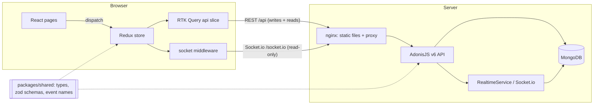
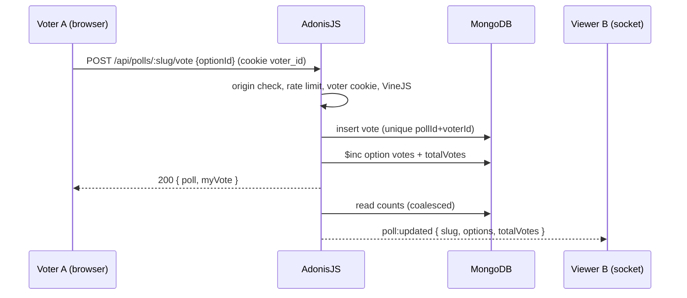

# Architecture

LivePoll is a small real-time polling app. This document explains how the pieces fit and why they
are built the way they are. Individual decisions (with the alternatives that were discarded) are
logged in [DECISIONS.md](./DECISIONS.md).



## The three packages

| Package           | Role                                                                                                                                                                                 |
| ----------------- | ------------------------------------------------------------------------------------------------------------------------------------------------------------------------------------ |
| `packages/shared` | The contract: DTO types, error codes, validation `LIMITS`, zod schemas, Socket.io event names and payload types. Both apps import it, so an event can't be renamed on one side only. |
| `apps/api`        | AdonisJS v6 HTTP API, Mongoose models, custom cookie auth, Socket.io attached to the same Node HTTP server.                                                                          |
| `apps/web`        | React 19 + Vite. Redux Toolkit store with an RTK Query API slice, an `auth` slice, a `poll` slice (live state of the poll on screen) and a socket middleware.                        |

## Why Mongoose instead of Lucid

Lucid, the AdonisJS ORM, only speaks SQL. The spec requires MongoDB, so the API uses Mongoose and
skips Lucid and `@adonisjs/auth` (whose guards expect a Lucid user model):

- `providers/mongoose_provider.ts` connects in the provider's `start()` hook, before the HTTP
  server accepts requests, waits for the indexes (`Model.init()`), and disconnects on `shutdown()`.
- Models are plain Mongoose modules (`app/models/*.ts`) imported where needed, with no extra
  container binding.
- Auth is ~60 lines: scrypt hashing via the Adonis `hash` service, a signed httpOnly session
  cookie (`app/services/session.ts`) and an `auth` middleware that loads the user from MongoDB.

## REST for writes, sockets for reads

Every state change (register, create, **vote**, close) is a REST call. Socket.io only pushes
data out:

| Client → server       | Server → clients                                                     |
| --------------------- | -------------------------------------------------------------------- |
| `poll:join { slug }`  | `poll:state { poll }` to the joining socket                          |
| `poll:leave { slug }` | `poll:presence { slug, count }` to the room on join/leave/disconnect |
|                       | `poll:updated { slug, options, totalVotes }` after every vote        |
|                       | `poll:closed { slug }` when the creator closes the poll              |

Why:

- **One write path.** Validation, rate limiting, cookies, error format and tests all live in the
  HTTP layer. A socket write path would need all of it a second time.
- **The client gets a clear answer.** `200`, `409 ALREADY_VOTED`, `409 POLL_CLOSED` and `422` are
  plain HTTP responses the UI can handle, with no acknowledgement protocol over the socket.
- **Sockets stay cheap and stateless.** A socket only says "I'm watching poll X". If it drops,
  nothing is lost: the client re-joins and re-reads.

After a successful vote the service calls `realtime.pollUpdated(slug)`. Broadcasts are
**coalesced** per poll. While one broadcast is reading the latest counts from MongoDB, further
votes only set a "dirty" flag, which triggers exactly one more read afterwards. The reads are
sequential, so clients can't receive an older snapshot after a newer one, and a burst of 50 votes
becomes a handful of messages instead of 50.

## How double votes are prevented

The `votes` collection is the source of truth; the counters on a poll are derived from it.

```
votes:  unique index on (pollId, voterId)
polls:  options[].votes and totalVotes, only ever changed with $inc
```

**New vote**

1. `Vote.create({ pollId, voterId, optionId })`. If the voter already voted, MongoDB rejects the
   insert with a duplicate-key error (E11000). This is atomic: of 20 parallel requests from the
   same voter, exactly one insert succeeds. There is no "check, then insert" race because there
   is no separate check.
2. Only after the insert succeeds: `$inc` the chosen option and `totalVotes` in a single
   `findOneAndUpdate` (positional `arrayFilters`).

**Vote change** (when `allowVoteChange` is on and the insert hit E11000)

1. Read the voter's current vote (`from`).
2. **Compare-and-swap:** `updateOne({ _id, optionId: from }, { optionId: to })`. If another
   request changed the vote in between, the filter no longer matches, `modifiedCount` is 0, and
   this request re-reads and retries (up to 10 times, then `409 CONFLICT`).
3. `$inc` `+1` on `to` and `-1` on `from` in one update.

`$inc` is atomic and **commutative**, so it doesn't matter in which order parallel requests apply
their increments: the final counters equal the vote documents. The concurrency tests in
`apps/api/tests/functional/votes.spec.ts` prove it with 50 parallel voters, 20 parallel duplicate
votes from one voter, and 20 parallel vote changes, then compare every counter with
`Vote.countDocuments`. Removing the `optionId: from` condition from the swap makes the vote-change
test fail with drifted counters (checked by hand).

**Why no transactions?** Every vote `$inc`s the same poll document. Under transactions, parallel
votes would abort each other with WriteConflict and retry in a storm; that also needs a replica
set. The trade-off: if the process dies (or MongoDB becomes unreachable) between the insert and
the `$inc`, that one vote is stored but not counted. A periodic recount from `votes` would repair
it (listed under "What I'd do next" in the README).

**Closed polls.** The open/closed check runs when the request starts, so a closed poll answers
`409 POLL_CLOSED`. A vote that passed the check a few milliseconds before the poll closed is
still counted, so counters and vote documents always agree.

**Who is a voter?** A random UUID in a **signed**, httpOnly cookie (`voter_id`, 1 year). Signing
means nobody can claim someone else's id; httpOnly means page scripts can't read it. Clearing
cookies or using another browser gives a new identity: that is the accepted limit of anonymous
voting without accounts.

## Reconnect strategy

All socket code lives in `apps/web/src/store/socketMiddleware.ts`. Components never touch the
socket. The poll page dispatches `watchPoll(slug)` on mount and `unwatchPoll(slug)` on unmount.

1. **Lazy connect.** The socket is created on the first `watchPoll`. Landing and dashboard pages
   never open a WebSocket.
2. **Join only when connected.** If the socket is offline, `watchPoll` just remembers the slug
   and calls `connect()`. The `connect` handler joins the remembered room. This avoids
   socket.io's offline send buffer replaying a duplicate join.
3. **On every reconnect** (socket.io retries network drops with exponential backoff by itself):
   - re-emit `poll:join` for the current poll: the server answers with a fresh `poll:state` and an
     updated presence count;
   - refetch `GET /api/polls/:slug` through RTK Query (`forceRefetch`), because votes or a close
     may have happened while offline and `myVote` only comes from REST.
   - socket.io-client does **not** retry when the _server_ ends the connection
     (`io server disconnect`), so the middleware calls `connect()` itself in that case. The server
     also avoids sending that reason on shutdown: it only closes the transports, so clients see
     an ordinary `transport close` during a restart.
4. **Connection status** (`connecting` / `connected` / `disconnected`) is stored in the poll slice,
   and the page shows "Connection lost. Reconnecting… results may be out of date." while disconnected.

On the server, `disconnecting` captures the socket's poll rooms and `disconnect` recounts them,
so the "N people viewing" counter drops as soon as a tab closes. A join **subscribes to the room
first and then reads the snapshot**, so a close or vote broadcast during the read can't be lost.
The socket remembers the slug it _last_ asked for: a `leave`, or a join for another poll, that
arrives during the read makes the pending join step back out of the room (no ghost viewer).

Four client-side rules keep the live state consistent when REST and socket messages race:

- **No voting before the voter is known.** The socket snapshot may render results before the first
  `GET` has answered (and issued the `voter_id` cookie). The vote form stays disabled until a REST
  response has told us this voter's vote, so one tab can't end up with two voter identities.
- **Older reads never win.** A `GET` that started before a vote can't overwrite the newer `myVote`.
- **Closed is final.** A REST response read before the poll closed can arrive after the live
  `poll:closed`; the poll slice never turns `closed` back into `open`.
- **A 409 on vote refetches the poll** (e.g. you already voted in another tab), so the page shows
  the real state instead of a form that can't succeed.

## Request lifecycle (vote)



## Security in one place

| Concern           | Where                                                                                                                                                    |
| ----------------- | -------------------------------------------------------------------------------------------------------------------------------------------------------- |
| Input validation  | VineJS validators (`app/validators`) + `SLUG_PATTERN` route matcher + zod on socket payloads                                                             |
| Passwords         | scrypt via Adonis `hash`; constant-ish time login for unknown emails                                                                                     |
| Sessions / voters | Signed httpOnly cookies, `SameSite=Lax`, `Secure` in production, server-side expiry in the session payload                                               |
| CSRF              | JSON-only body parser + `Origin` allow-list check on every non-GET request + SameSite cookies                                                            |
| Rate limiting     | `@adonisjs/limiter`: auth 10/min/IP, votes 60/min/IP; only the immediate proxy hop is trusted                                                            |
| Error leakage     | Custom exception handler: `{ error: { code, message } }`, generic 500, never a stack trace                                                               |
| Headers           | API: nosniff, frame DENY, CSP `default-src 'none'`, HSTS in prod. nginx: CSP `default-src 'self'` for the SPA                                            |
| CORS              | Allow-list from `CORS_ORIGINS`, shared with Socket.io                                                                                                    |
| Secrets           | Only `.env.example` (empty key) and `.env.test` (a test-only key the app refuses in production) are committed; Docker generates `APP_KEY` on first start |
| Injection         | Mongoose `sanitizeFilter`, typed validation, ObjectId matching done in JS before any query                                                               |
